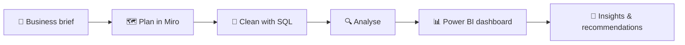

<!-- Header -->


<div align="center">

<a href="https://github.com/Rocky101798">
  
</a>

<br/>

<a href="https://www.linkedin.com/in/godfrey-siphamandla-moyo-761aba152"></a>
<a href="mailto:godfreymoyo8@gmail.com"></a>


</div>

---

### 👋 About me

```yaml
role:        Fraud Detection Consultant @ Standard Bank Group
experience:  2+ years turning high-volume transaction data into decisions (banking & fraud)
projects:    Banking · Retail · Media & streaming · Automotive
education:   PGDip Risk Management · BA Communication Science (UNISA)
certified:   [AWS Cloud Practitioner, Microsoft Power BI]
learning:    AWS Cloud Data Engineer path ☁️
               - AWS Certified Solutions Architect – Associate
               - AWS Certified Data Engineer – Associate
goal:        Build data solutions & cloud pipelines in any industry
target:      Data Analyst · Business Analyst · Data Engineer
```

---

### 🚀 Featured projects

<table>
<tr>
<td width="50%" valign="top">

#### 🏦 [Banking & Finance Analysis](https://github.com/Rocky101798/SQL-Projects-/tree/main/banking-finance-analysis)
Cleaned **5,600 messy rows** across customers, accounts and transactions in Databricks, then built a 5-page Power BI dashboard.
<br/>**Found:** 36.9% of transactions failing · 47% of customers with poor credit.

`SQL` `Databricks` `Power BI` `DAX`

</td>
<td width="50%" valign="top">

#### 📺 [BrightTV Viewership Analytics](https://github.com/Rocky101798/BrightLearn-TV-)
What makes people watch more? Session-level analysis (UTC → SAST) to help grow subscribers and usage.
<br/>**Live:** [interactive dashboard ↗](https://siphamandlam.lovable.app)

`SQL` `Databricks` `Power BI` `Excel`

</td>
</tr>
<tr>
<td width="50%" valign="top">

#### 🚗 [Bright Motors Car Sales](https://github.com/Rocky101798/Motors-CarSales-Analysis)
Stock, pricing and expansion insights for a new Head of Sales: makes, mileage, market value (MMR) and regional trends.

`SQL` `Power BI` `Excel` `Miro`

</td>
<td width="50%" valign="top">

#### ☕ [Bright Coffee Shop Sales](https://github.com/Rocky101798/coffee-shop-data-analysis)
Top store, peak hours (8–10 AM) and best and worst products, turned into a staffing and menu plan.

`BigQuery` `Power BI` `Excel` `Miro`

</td>
</tr>
</table>

<details>
<summary><b>🧪 SQL practice & learning repos</b></summary>
<br/>

| Repo | What's inside |
|---|---|
| [SQL-Practice-](https://github.com/Rocky101798/SQL-Practice-) | Cleaning messy employee, hospital and hotel data; CTE pipelines, `ROW_NUMBER()` dedup, multi-table JOINs |
| [BigQuery-Practice](https://github.com/Rocky101798/BigQuery-Practice) | BigQuery drills on coffee and retail sales datasets |
| [BrightLearn-Exercises](https://github.com/Rocky101798/BrightLearn-Exercises) | Weekly course exercises: SELECT → aggregates → CASE → JOINs |

</details>

---

### 🧭 How I approach every project



Every case-study repo follows the same layout, so you always know where to look:
`01-brief-and-raw-data` → `02-project-planning` → `03-sql-analysis` → `04-dashboard-and-presentation`

---

### 🛠️ Toolkit

<p><b>Data & BI</b><br/>
      
</p>

<p><b>Cloud</b><br/>
  
</p>

<p><b>Domain experience: banking, fraud & risk</b><br/>
    
</p>

<p><b>Planning & productivity</b><br/>
   
</p>

---

### 📈 Currently

- ☁️ Completing my **AWS Cloud Data Engineer** certifications: **Solutions Architect – Associate** and **Data Engineer – Associate**
- 🧠 Levelling up advanced SQL: window functions, CTE pipelines, query performance
- 🌍 Applying data skills **across industries**: banking, retail, media, automotive and beyond
- 🤝 Open to **Data Analyst, Business Analyst and Data Engineering roles**, plus freelance analytics for SMEs

<div align="center">

*Always learning. Always improving.* ⭐


</div>
